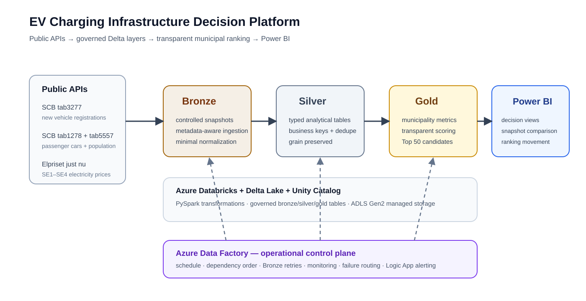
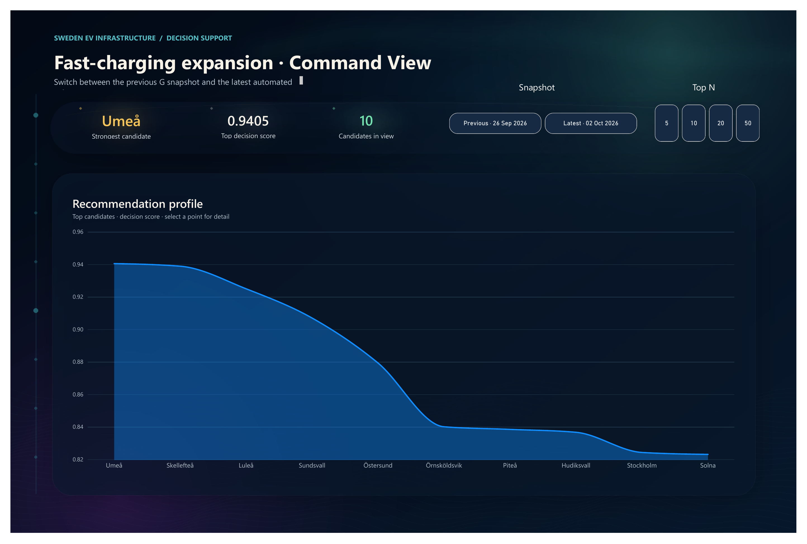
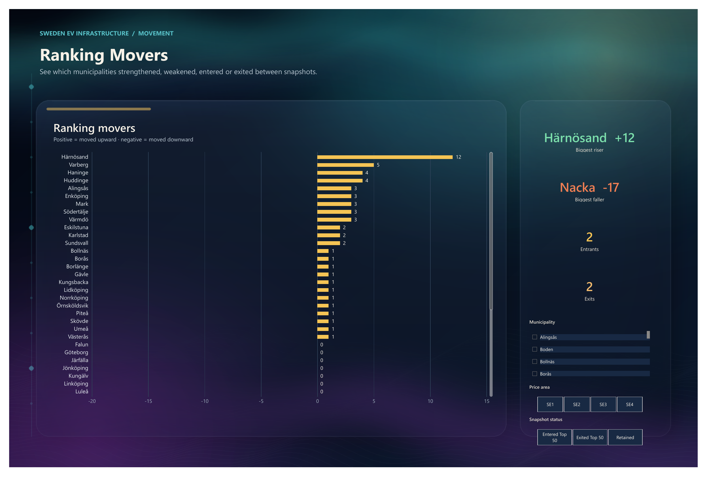

# EV Charging Infrastructure Decision Platform

A portfolio data-engineering project that turns public Swedish transport and electricity-price data into a governed, reproducible ranking of municipalities for fast-charging infrastructure planning.

**Stack:** Azure Databricks · PySpark · Delta Lake · Unity Catalog · ADLS Gen2 · Azure Data Factory · Logic Apps · Power BI

The platform answers a deliberately bounded question: **which Swedish municipalities should be prioritized when planning 50 new fast-charging stations?** It ranks municipalities; it does not choose exact streets or allocate a fixed number of chargers to each municipality.

**Quick review:** [Databricks implementation](databricks/README.md) · [ADF orchestration](adf/README.md) · [Power BI layer](powerbi/README.md) · [Evidence map](docs/evidence.md)

## Architecture



The transformation logic stays in **Azure Databricks**. **Azure Data Factory (ADF)** acts as the operational control plane for dependency order, scheduling, retries, monitoring, failure routing, and alerting.

## What the project demonstrates

- Metadata-aware ingestion from public APIs rather than blindly relying on stale dimension values.
- Bronze / Silver / Gold Delta tables governed through Unity Catalog.
- PySpark transformations that preserve source grain until the Gold decision model.
- Explicit duplicate/null checks and deterministic full-refresh reruns.
- A transparent three-factor scoring model for EV volume, recent EV growth, and electricity price.
- ADF orchestration with bounded retries on the external-API stage and stage-specific failure routing.
- Logic App notification delivery and an operational runbook for troubleshooting and safe reruns.
- A Power BI semantic model and six business-facing views, including snapshot comparison and ranking movement.

## Data sources

| Source | Use in the project | Verified scope |
|---|---|---:|
| SCB `tab3277` | New vehicle registrations | 290 municipalities × 8 fuel categories × latest 12 months = 27,840 rows |
| SCB `tab1278` | Passenger-car stock | 290 rows, reference year 2025 |
| SCB `tab5557` | Population | 290 rows, reference year 2025 |
| Elpriset just nu | Electricity prices | SE1–SE4, rolling 30-day window, 11,520 observations in the verified run |

**Important:** EV registrations are used as a transparent **demand proxy**. They are not measured charger demand and are not the current stock of electric vehicles.

## Bronze → Silver → Gold

**Bronze** stores controlled source snapshots with minimal technical normalization. The SCB ingestion reads metadata before constructing requests and keeps all eight selected fuel categories in the raw registration snapshot.

**Silver** converts the snapshots into typed analytical tables at their natural grains. In the verified implementation, all four Silver tables passed duplicate and null checks.

**Gold** reconciles the grains into municipality-level decision support. `municipality_metrics` contains one row per municipality; `top_50_charging_candidates` materializes the ranked business result.

## Decision model

The three decision criteria are transformed to comparable 0–1 scores:

1. **EV volume** — percentile rank over EV registrations during the latest 12 months.
2. **EV growth** — percentile rank over the absolute change between the recent six months and the previous six months.
3. **Electricity price** — inverse min–max normalization of the average price-area electricity price, so lower price receives a higher score.

The final score uses equal weighting:

```text
decision_score = (ev_volume_score + ev_growth_score + electricity_price_score) / 3
```

Equal weighting is intentional: no stakeholder preference was specified between the three criteria, so the implementation does not silently invent one.

## Orchestration and reliability

The ADF pipeline runs the three Databricks jobs in dependency order:

```text
Bronze ingestion → Silver transformation → Gold decision support
```

Bronze crosses external API/network boundaries, so it has a bounded retry policy: **2 retries**, **60-second retry interval**, **1-hour timeout**. Silver and Gold use the failure-notification pattern without pretending that immediate API-style retries are the correct recovery strategy for deterministic transformation errors.

Each processing stage has an `On Failure` notification branch followed by an explicit stage-specific `Fail` activity. The public ADF files in this repository are sanitized: Logic App callback URLs, workspace identifiers, and job IDs are replaced with placeholders.

### Scheduling evidence vs. intended cadence

The exported trigger definition in `adf/trigger/` reflects the **executed verification window**: Friday, 2 October 2026 at 16:45 Stockholm time. The intended operating cadence documented by the project is **weekly Monday at 06:00 Stockholm time**. Those two facts are intentionally kept separate rather than rewriting historical evidence.

## Data quality and reproducibility

The verified quality contract includes:

- 290 current municipalities in the Gold model.
- Silver registration table: 27,840 rows, 0 duplicates, 0 nulls.
- Silver passenger-car stock: 290 rows, 0 duplicates, 0 nulls.
- Silver population: 290 rows, 0 duplicates, 0 nulls.
- Silver electricity prices: 11,520 rows, 0 duplicates, 0 nulls.
- Gold candidate result: 50 rows, 50 unique municipalities, 50 unique ranks, rank range 1–50, no null/invalid scores.

This project uses a full-refresh overwrite strategy because the relatively small datasets represent the current analytical snapshot. **Idempotency here means that rerunning the same input snapshot does not accumulate duplicate records.** It does not mean that public APIs return identical business values on different dates.

## Power BI



The repository includes the PBIP report/semantic-model source plus the public snapshot workbook. The dashboard has six analytical views:

- Command View
- Candidate Geography
- Demand vs Cost
- Decision Anatomy
- Ranking Movers
- Snapshot Comparison

The latest automated snapshot shown in the portfolio places **Umeå, Skellefteå, and Luleå** at the top. The earlier verified baseline snapshot had a different ordering because the public source data was refreshed; the scoring logic did not change.



The snapshot comparison shows 48 retained municipalities, 2 entrants, and 2 exits. Notable movements include Härnösand at +12 ranks and Nacka at -17 ranks.

## Evidence status

The repository keeps three verification claims separate:

- **Executed:** on 2 October 2026, the schedule trigger fired and the Bronze → Silver → Gold success path completed.
- **Validated/published:** the final three-stage failure-management topology was added afterward and validated by ADF.
- **Independently verified:** on 5 October 2026, the production Logic App HTTP endpoint was tested with a controlled failure payload and delivered the structured email notification.

A deliberate end-to-end Databricks processing failure was **not** induced solely to manufacture evidence.

See [`docs/evidence.md`](docs/evidence.md) for the evidence map and [`docs/operations.md`](docs/operations.md) for the operational handover.

## Repository structure

```text
architecture/     portfolio architecture diagram and notes
databricks/       sanitized notebooks and plain-Python source exports
adf/              sanitized pipeline, trigger and linked-service definitions
powerbi/          PBIP/TMDL source, snapshot workbook and dashboard screenshots
docs/             evidence map, operational guidance and selected proof images
```

## Limitations

This is municipality-level decision support, not a final charger-site selection model. Exact site selection would need additional local data such as traffic flows, existing charging infrastructure, road access, grid capacity, land use, and site constraints. The embedded municipality-to-price-area mapping is also a controlled notebook mapping; a production implementation should externalize it to a governed reference dataset.

## Academic context

The project was completed in the Data Engineer program at Nackademin, in the course *Data Platforms and Cloud Solutions*. The repository is organized as a technical portfolio artifact rather than as a copy of the school submission.
